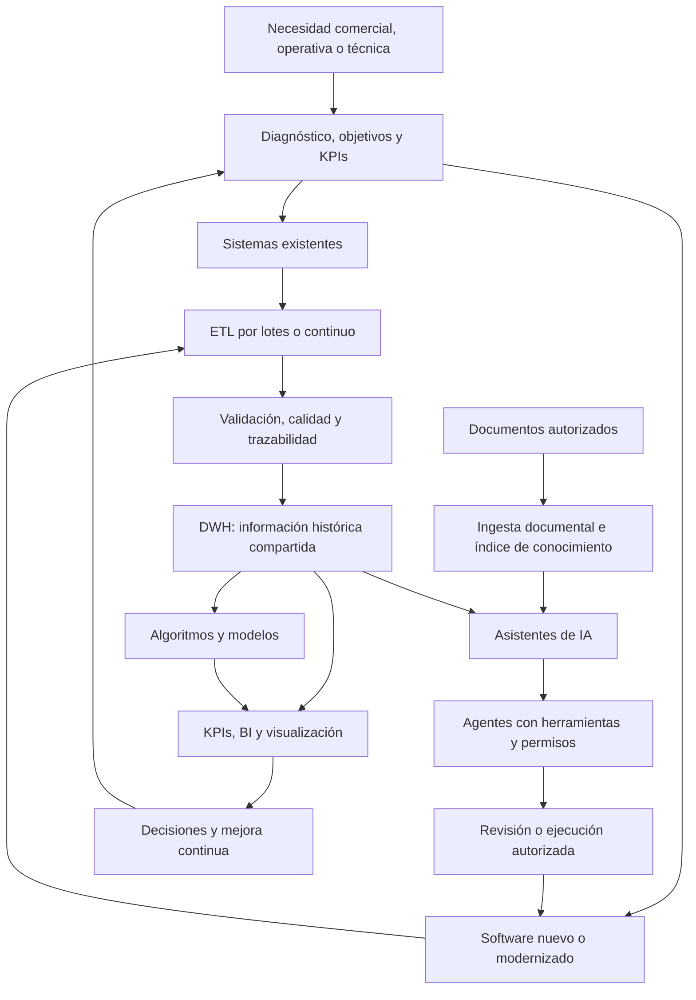
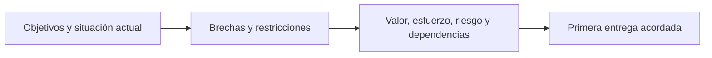
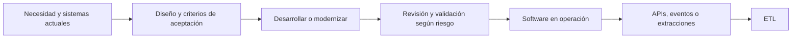
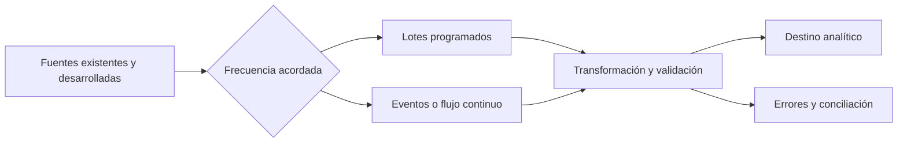
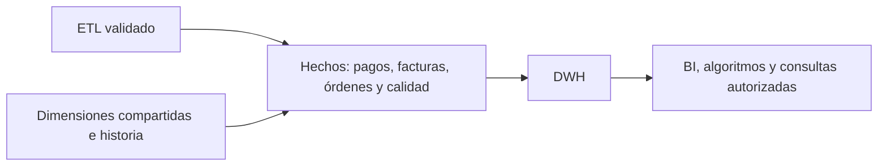
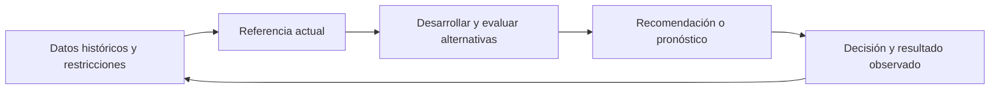
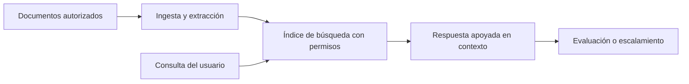
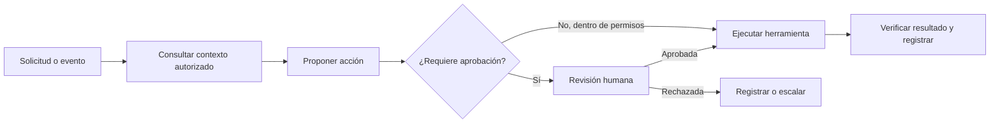
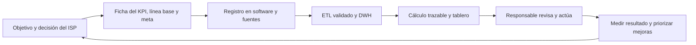

# Guía de servicios para ISPs de Honduras

**Actualizado:** 2026-11-15. Documento interno de estudio y preparación comercial.

**Landing:** `/isp-honduras` (`src/pages/isp-honduras.astro`).

**Contenido comercial:** `src/data/ispCampaign.ts`.

## 1. Qué vendemos

Una solución que conecta negocio, software y ciclo completo de datos. HGuerra combina consultoría, implementación y acompañamiento. No ofrece un SaaS listo, conectividad, instalación física de redes ni NOC 24/7.

**Explicación breve:** «Ayudo a tu ISP a proteger ingresos, coordinar el servicio y decidir con evidencia. Desarrollo o modernizo el software que necesita, lo integro con sus sistemas y conecto todo el ciclo de datos para abordar una prioridad concreta».

El software nuevo o modernizado se diseña para alimentar el ETL mediante interfaces, eventos o extracciones autorizadas. No es una aplicación aislada. Los servicios son frentes de trabajo contratables por alcance; no todos requieren IA, streaming ni todos los componentes del esquema.

**Los KPIs son un pilar transversal, no un agregado del tablero.** Se definen desde los objetivos y decisiones del negocio; determinan qué eventos debe registrar el software, qué valida el ETL, cómo se relaciona la información en el DWH y cómo se evalúan los resultados. Se acompañan con responsables y acciones de mejora.

**Uso comercial de esta guía:** el detalle sirve para preparar la conversación, no para exigir su lectura antes de contactar. El catálogo original de nueve servicios se conserva aquí, con sus diagramas y referencias. La landing vende una primera intervención contratable, no tecnologías independientes ni una conversación sin propósito. Su recorrido es beneficio → problemas reconocibles y cómo ayuda HGuerra → ejemplo transversal de reclamos en una zona → ingeniería que respalda la oferta → confianza, entregables y contratación → consulta → dudas finales. El formulario de campaña sigue pidiendo solo correo y necesidad; el motivo interno es `otro` y conserva el origen ISP. El formulario general mantiene su selector.

### Criterio de la landing comercial

- **Promesa:** «Protegé ingresos. Coordiná mejor. Decidí con evidencia».
- **Una acción principal:** «Evaluar una mejora para mi ISP», que abre la consulta dentro de la misma página. No reserva una cita ni entrega automáticamente un diagnóstico.
- **Demostración principal:** una zona acumula reclamos; técnica relaciona eventos y servicios, operación dispone de antecedentes y responsables, comercial da seguimiento y gerencia evalúa la siguiente intervención. Relacionar reclamos y bajas no demuestra por sí solo una causa. El ejemplo de prospecto → orden → activación → servicio se conserva como aplicación complementaria desplegable. Ninguno es un caso propio ni una captura de producto existente.
- **Confianza:** perfil y experiencia de Héctor, atención directa, alcance acordado y transferencia. No se sustituyen casos inexistentes por testimonios o logotipos ficticios.
- **Referencia comercial del plan aprobado:** [CXL, How to Build a High-Converting Landing Page](https://cxl.com/blog/how-to-build-a-high-converting-landing-page/) y [HubSpot, Estructura de una landing page que convierte](https://blog.hubspot.es/website/estructura-landing-page-que-convierte). Se aplican foco, beneficios, secuencia, demostración y menor fricción; sus estadísticas no son resultados de HGuerra.
- **Evaluación comercial pendiente:** contar consultas reales de ISPs con una necesidad y encaje identificables, después oportunidades y contrataciones. El evento de envío aceptado por EmailJS no acredita entrega en bandeja, consulta calificada ni venta. La instrumentación existente no clasifica oportunidades automáticamente.

### Ocho problemas como fundamento del argumento de compra

El propietario aprobó partir de los puntos de dolor recuperados del RAG, no del catálogo de capacidades. La biblioteca mezcla experiencias de operadores internacionales, buenas prácticas y regulación; **no es un ranking estadístico de problemas de ISPs hondureños**. Las formulaciones comerciales son situaciones propuestas para reconocer y validar, no testimonios ni un diagnóstico previo del visitante.

| Frente | Qué puede abordar HGuerra con software y datos | Sustento y límite de la inferencia |
| --- | --- | --- |
| Competencia, pérdida de clientes y presión sobre el margen | Seguimiento comercial, integración de altas/facturación y análisis de ingresos y bajas por plan o segmento. La rentabilidad requiere costos; ARPU no mide margen. | [R5], p. PDF 29: competencia, descuentos, ARPU, churn y margen. No extrapolar cifras o resultados al mercado hondureño. |
| Complejidad de planes, tarifas y facturación | Módulos e integraciones con reglas compartidas y conciliación. | [R5], §«Our Strengths», desde p. PDF 13: plataforma unificada de facturación. No prueba errores de cobro o morosidad en todos los ISPs. |
| Coordinación de atención, citas y trabajo técnico | Apps de órdenes/campo e integración de agenda, atención, inventario y responsables. | [R5], §«Our Strengths»: coordinación de citas y asistencia a técnicos. |
| Incidentes que vuelven a ocurrir | Relacionar tickets, configuración, cambios y errores conocidos para investigar y priorizar. | [R6], pp. PDF 29–32: incidentes y gestión de problemas. Es una necesidad de gestión, no evidencia de prevalencia local. |
| Disponibilidad y continuidad | Contextualizar monitoreo y apoyar priorización según servicios afectados. | [R6], p. PDF 19. El software no sustituye mantenimiento ni intervenciones físicas de red. |
| Capacidad y degradación del rendimiento | Análisis de utilización/demanda y modelos evaluados cuando haya historia suficiente. | [R6], p. PDF 21, y [R5], §«Our Strengths». Sin prometer predicción cierta o evitar todas las fallas. |
| Datos desconectados e indicadores inconsistentes | Instrumentación, ETL/ELT validado, modelo compartido y KPIs trazables. | Inferencia de diseño apoyada en [R3], `Kimball_DWH.pdf`, pp. PDF 4 y 13–14; no frecuencia medida en ISPs. |
| Seguridad de información y continuidad | Permisos, registro de acciones y recuperación acordada de los componentes entregados. | [R5], p. PDF 33: riesgos de seguridad. No se ofrece seguridad integral, SOC, invulnerabilidad o cumplimiento garantizado. |

En la landing, `ispChallenges` agrupa los seis primeros en tres argumentos (comercial, operativo y técnico), cada uno con situación, intervención, decisión y KPIs. `ispFoundations` presenta los dos transversales. No se duplican en la sección de ingeniería: esta conserva arquitectura y capacidades, ahora con «Qué aborda» y «Entregable».

### Profundidad para un gerente técnico con conocimiento del negocio

El propietario precisó que la landing también debe permitir evaluar la ingeniería. Los principios comerciales de CXL y HubSpot siguen vigentes: ordenar el argumento y facilitar la acción no significa esconder capacidades relevantes. El póster «Un ISP en tres capas» orienta la separación comercial, operativa y técnica; no acredita resultados, compatibilidad o servicios de instalación de redes.

La sección pública `/isp-honduras#ingenieria`, implementada en `src/components/sections/IspEngineering.astro`, incorpora:

1. **Arquitectura no lineal:** `IspArchitecture.astro` muestra tres carriles sobre fondo claro: sistemas → ETL/ELT → DWH → KPIs o modelos; documentos → ingesta/índice → RAG → soporte; contexto → reglas/agentes → control/aprobación → sistemas. Calidad, permisos, trazabilidad y seguimiento son transversales.
2. **Ocho grupos de capacidades con problema y entregable visibles:** objetivos/KPIs/hoja de ruta; software; integración; DWH; algoritmos; conocimiento; automatización/agentes; visualización/mejora continua. El último reúne tableros y evolución sin eliminar el desarrollo de ambas disciplinas en esta guía.
3. **Límites complementarios bajo demanda:** dependencias de integración, evaluación de modelos, permisos y acompañamiento. Lo esencial no queda oculto detrás de desplegables.

El modelo de datos debe integrar las áreas mediante definiciones compartidas, no imponer tres DWH aislados: [R2], p. PDF 6, y [R3], `Kimball_DWH.pdf`, pp. PDF 13–14. La finalidad y frecuencia de reportes, disponibilidad y capacidad se apoyan en [R6], pp. PDF 17, 19 y 21, recuperadas durante la planificación. Los ejemplos de KPIs siguen siendo propuestas a validar, no fórmulas normativas.

El esquema anterior de cinco pasos, que agrupaba algoritmos, IA y agentes antes de la visualización, se sustituyó porque podía sugerir una dependencia obligatoria de IA y no distinguía operación, analítica y conocimiento. El DWH no reemplaza los sistemas transaccionales ni el repositorio documental; usar RAG o agentes es una decisión por caso. ETL y ELT describen alternativas de transformación según el diseño, no una promesa de compatibilidad o actualización instantánea.

El DWH no sustituye la base transaccional. Los documentos pueden requerir almacenamiento e índices propios para IA. Un agente puede consultar sistemas operativos mediante herramientas autorizadas cuando necesita información actual; eso no elimina la ingesta de sus datos al ciclo analítico. Tiempo real significa una latencia acordada, no instantaneidad garantizada.

## 2. Diagnóstico y hoja de ruta

- **Dolor:** muchas oportunidades sin una prioridad ni claridad sobre dependencias o inversión.
- **Trabajo:** revisar procesos, software, datos, responsables, restricciones y capacidades de adopción; definir estado objetivo, KPIs, línea base, brechas y una primera intervención.
- **Entradas → entregables:** objetivos y evidencia del ISP → alcance, prioridades, dependencias, responsables y criterios de aceptación.
- **Valor y evaluación:** claridad para decidir; cada iniciativa debe tener un problema, un responsable y una forma de evaluar el avance.
- **Límite:** no es una certificación ni una evaluación universal obligatoria. Una necesidad ya definida permite empezar por su alcance.
- **Base RAG:** [R1], [R2].

## 3. Desarrollo y modernización de software

- **Dolor:** falta una herramienta o la existente obliga a trabajar con procesos manuales y sistemas desconectados.
- **Trabajo:** construir aplicaciones, módulos y APIs; modernizar interfaces, reglas o integraciones existentes. Definir cómo sus datos ingresan al ETL desde el diseño.
- **Ejemplos ISP:** módulo de ventas y altas, portal de abonados, órdenes de instalación, gestión de reclamos, inventario de equipos o cambios técnicos.
- **Entradas → entregables:** proceso, usuarios, reglas y restricciones → versión funcional, interfaces de integración, validaciones, documentación y transferencia.
- **Valor y evaluación:** completar el proceso; evaluar errores, tiempos de gestión, adopción y cumplimiento de criterios acordados.
- **Controles:** permisos, integridad de datos y migraciones por alcance; cambios graduales para no comprometer la operación. No reemplazar sistemas por defecto.
- **Base RAG:** [R3], [R4], [R8].

**Agentes de desarrollo ≠ agentes del ISP.** Los primeros asisten a Héctor durante la construcción. Las prácticas se eligen o combinan según alcance, incertidumbre y riesgo, con dirección y revisión técnica. Buscamos menos retrabajo, costos contenidos, entregas útiles más rápidas y evolución sostenible; las fuentes no prueban porcentajes de ahorro ni resultados propios de HGuerra.

## 4. Integración de datos: ETL por lotes o en tiempo real

- **Dolor:** copiar datos, conciliar archivos manualmente y decidir con información incompleta o tardía.
- **Trabajo:** extraer, transformar, validar y cargar datos de facturación, pagos, CRM, órdenes, aplicaciones desarrolladas y monitoreo. Definir identificadores, frecuencia, reglas, reintentos y manejo de errores.
- **Entradas → entregables:** fuentes autorizadas → flujos documentados y supervisados, datos preparados para los destinos y seguimiento de fallos.
- **Lotes:** apropiados, por ejemplo, para conciliaciones y cierres periódicos.
- **Continuo:** apropiado cuando actuar antes justifica el costo y las interfaces lo permiten. Evaluar eventos, captura de cambios o consultas periódicas; no son intercambiables.
- **Valor y evaluación:** latencia de actualización, conciliación con la fuente, registros rechazados y tiempo de recuperación.
- **Controles:** calidad, duplicados, reejecución segura, evolución de esquemas y acceso limitado. No garantizar compatibilidad sin revisar las fuentes.
- **Base RAG:** [R2], [R3].

## 5. Almacén de datos empresarial — DWH

- **Dolor:** distintas áreas calculan clientes, ingresos o calidad de forma incompatible.
- **Trabajo:** modelar procesos e históricos con granularidad explícita y dimensiones compartidas: cliente, servicio, zona, equipo, tiempo y otras que el alcance necesite.
- **Entradas → entregables:** datos validados por ETL → modelo histórico consultable, definiciones compartidas y acceso por rol.
- **Ejemplo ISP:** relacionar facturación y pagos con servicios activos, órdenes y calidad sin confundir ingresos facturados, cobrados o reconocidos.
- **Valor y evaluación:** conciliación con fuentes, consistencia de indicadores e historia disponible para decisiones.
- **Límite:** el DWH no reemplaza el sistema que registra pagos o activa servicios. Definir retención y acceso a datos personales.
- **Base RAG:** [R2], [R3], [R8].

## 6. Algoritmos, predicción y optimización

- **Dolor:** reaccionar tarde a bajas o saturación y asignar recursos sin criterios comparables.
- **Trabajo:** formular el problema, establecer una referencia simple y evaluar reglas, estadística, modelos predictivos u optimización matemática.
- **Ejemplos ISP:** estudiar riesgo de bajas, proyectar demanda o capacidad y apoyar asignaciones considerando disponibilidad, ubicación y restricciones.
- **Entradas → entregables:** históricos y restricciones → modelo o algoritmo evaluado, resultados utilizables y límites documentados.
- **Valor y evaluación:** error de proyección, utilidad de la priorización o mejora frente a la regla actual, según el problema.
- **Límites:** no confundir correlación con causa. Verificar historia suficiente y calidad; una predicción no garantiza un resultado. Las decisiones comerciales o técnicas sensibles mantienen responsables.
- **Base RAG:** [R5], [R6]. Son apoyo a las aplicaciones propuestas, no prueba de un modelo ya implementado por HGuerra.

## 7. IA para documentos y conocimiento

- **Dolor:** soporte y administración dependen de buscar manuales o consultar a pocas personas.
- **Trabajo:** ingesta documental, extracción, búsqueda y respuestas apoyadas en fuentes autorizadas. Evaluar calidad, actualidad y permisos.
- **Entradas → entregables:** manuales, procedimientos y documentos autorizados → repositorio consultable o asistente integrado al trabajo.
- **Valor y evaluación:** exactitud, respaldo en fuentes, capacidad de reconocer falta de información y utilidad para el equipo.
- **Límites:** recuperar documentos no elimina errores. No tratar instrucciones dentro de documentos como autorización para ejecutar acciones ni compartir datos entre usuarios sin permisos.
- **Base RAG:** [R7], [R4].

## 8. Agentes conectados con procesos

- **Dolor:** una persona debe coordinar cada consulta y traspaso entre sistemas incluso teniendo información.
- **Trabajo:** conectar herramientas para tareas delimitadas: clasificar solicitudes, enriquecer tickets, preparar acciones y ejecutar solo lo autorizado.
- **Entradas → entregables:** evento o solicitud, contexto y permisos → flujo con herramientas, trazabilidad, excepciones y puntos de revisión.
- **Valor y evaluación:** tareas completadas correctamente, intervenciones humanas, errores, costo y tiempo por proceso.
- **Controles:** privilegio mínimo, validación de argumentos, acciones idempotentes cuando corresponda y aprobación según consecuencias. No cortes, cobros o cambios de red autónomos por defecto.
- **Base RAG:** [R4]. No todo flujo requiere un agente: usar reglas deterministas cuando basten.

## 9. KPIs, gestión por indicadores e inteligencia de negocio

- **Dolor:** hay reportes, pero las áreas no comparten una definición de éxito ni saben qué acción tomar ante una desviación.
- **Trabajo:** definir los indicadores clave de desempeño con el decisor y los responsables del proceso; conectarlos con fuentes confiables, metas y acciones. Construir tableros por rol y navegación al detalle pertinente.
- **Entradas → entregables:** objetivos, decisiones y datos disponibles → catálogo de KPIs, línea base, metas acordadas, reglas de cálculo, trazabilidad, vistas por responsabilidad y seguimiento.
- **Valor y evaluación:** uso de los KPIs para priorizar y comprobar mejoras, consistencia de cálculos y tiempo para disponer de información. No medir éxito por cantidad de gráficos.
- **Límites:** las metas dependen de la estrategia y la línea base del ISP; no se inventan referencias universales. Mostrar período, actualización, cobertura y datos faltantes. No confundir una métrica interna con una medición regulatoria oficial.
- **Base RAG:** [R2], [R5], [R6], [R9].

### Ficha mínima de cada KPI

1. **Objetivo y decisión:** qué resultado importa y qué se hará con el indicador. Una métrica se convierte en KPI por su relación con una prioridad, no por aparecer en un tablero.
2. **Definición y fórmula:** numerador, denominador, unidad, población, granularidad, período y exclusiones. Evitar cambiar la fórmula sin versionarla.
3. **Fuentes y trazabilidad:** sistema de origen, eventos y campos, reglas del ETL, modelo del DWH y cálculo final.
4. **Línea base, meta y umbrales:** punto de partida, resultado deseado y criterios para intervenir, acordados con el ISP.
5. **Responsable y seguimiento:** quién responde por el resultado, frecuencia de revisión y acción ante desviaciones. La frecuencia de extracción no es necesariamente la de revisión gerencial.
6. **Calidad y límites:** datos faltantes, conciliación, duplicados, cobertura y cambios de definición. No presentar falta de datos como cumplimiento, cero incidentes o cero morosidad.

### Ejemplos gerenciales-técnicos para un ISP

Las siguientes son **definiciones iniciales propuestas**, no fórmulas normativas, estándares universales ni indicadores calculados para un cliente. Deben acordarse y adaptarse antes de implementar.

| Área / KPI | Definición inicial para acordar | Decisión que puede apoyar |
| --- | --- | --- |
| Comercial / Conversión a altas | Prospectos de una cohorte que terminan con servicio activado ÷ prospectos elegibles de esa misma cohorte × 100. Definir ventana de seguimiento y criterios de elegibilidad. | Identificar dónde se pierden ventas entre consulta, cotización e instalación. |
| Comercial / Bajas — churn | Abonados de la base activa inicial que se dan de baja durante el período ÷ abonados activos al inicio × 100. Definir qué cuenta como baja y cómo se tratan reactivaciones y suspensiones. | Priorizar retención y estudiar motivos, zonas o servicios afectados. |
| Comercial / ARPU | Ingreso recurrente del período ÷ base promedio de abonados activos, usando la misma unidad y servicio. Para ARPU mensual en un período de varios meses, normalizar por meses. | Analizar la evolución del ingreso por abonado y la mezcla de planes. No confundirlo con ingreso cobrado, margen o rentabilidad. |
| Comercial / Cartera vencida | Saldo vencido ÷ saldo total por cobrar al mismo corte × 100. Definir vencimiento, notas de crédito y bandas de antigüedad. | Priorizar seguimiento de cobro y revisar inconsistencias de facturación o pagos. |
| Operación / Tiempo de instalación | Tiempo entre aceptación de la orden y activación; analizar mediana y percentiles por cohorte o segmento. Mostrar también pendientes y su antigüedad, no solo instalaciones completadas. | Detectar cuellos de botella de agenda, materiales o coordinación. |
| Operación / Tiempo de resolución | Tiempo entre apertura y resolución efectiva del reclamo; fijar reglas para pausas y reaperturas. Distinguir primera respuesta, recuperación técnica y cierre administrativo. | Ajustar prioridades, escalamiento y recursos de atención. |
| Operación / Visitas repetidas | Órdenes atendidas que requieren otra visita por el mismo problema dentro de una ventana acordada ÷ órdenes elegibles de la cohorte × 100. | Revisar diagnóstico, materiales, información de la orden o criterio de cierre. |
| Técnica / Disponibilidad | Tiempo de servicio disponible ÷ tiempo de servicio esperado en el período × 100. Definir servicio, punto de medición, alcance y tratamiento de mantenimientos. Las brechas de monitoreo se reportan, no se consideran disponibilidad. | Priorizar continuidad, mantenimiento y atención de zonas afectadas. |
| Técnica / Latencia | Mediana o percentil acordado del tiempo de ida y vuelta, con origen, destino, horario y método de medición definidos. | Identificar degradación y contrastarla con el impacto reportado por clientes. |
| Técnica / Pérdida de paquetes | Paquetes perdidos ÷ paquetes enviados en mediciones válidas × 100, sobre una ruta y ventana definidas. | Investigar degradación; no concluir una causa únicamente por el valor del indicador. |
| Técnica / Utilización de capacidad | Tráfico observado ÷ capacidad efectiva del enlace × 100; revisar percentiles y hora pico por enlace o segmento, sin mezclar capacidades diferentes. | Priorizar ampliaciones y revisar capacidad antes de comprometer nuevas altas. |

**Qué debemos capturar desde el software:** identificadores consistentes de abonado, servicio, prospecto, orden e incidente; estados y sus fechas; importes con su significado; relación con equipos y zonas; y cambios relevantes. No todos esos campos aplican a cada proceso. La definición del KPI determina qué es necesario y cómo validarlo.

**Controles habilitadores:** frescura y calidad del dato, fallos del ETL, calidad de modelos, costo y corrección de acciones de agentes. Pueden ser KPIs si se vinculan con un objetivo de gestión; no deben desplazar los resultados comerciales, operativos o de servicio que se busca mejorar.

## 10. Operación y mejora continua

- **Dolor:** el proyecto se entrega, pero sus fallos, costos y evolución quedan sin responsables.
- **Trabajo:** seguimiento de software, flujos de datos, modelos y agentes; revisión de KPIs frente a línea base y metas; atención de fallos, gestión de cambios, documentación y transferencia.
- **Entradas → entregables:** evidencia de uso, incidentes y objetivos → prioridades de mejora, versiones y condiciones de acompañamiento.
- **Valor y evaluación:** disponibilidad pertinente, recuperación, calidad de datos/modelos, costo operativo y adopción.
- **Límites:** mantenimiento, alojamiento, atención y niveles de servicio se acuerdan; no se presume soporte ilimitado o NOC 24/7.
- **Base RAG:** [R2], [R3], [R6].

## Conversación comercial: vender el resultado, explicar la ingeniería

| Si el decisor dice… | Respuesta y siguiente pregunta |
| --- | --- |
| «Ya tenemos un sistema». | «Podemos integrarlo o completar lo que no resuelve. ¿Dónde sigue haciendo falta un archivo o una persona para pasar la información?» |
| «Necesito un dashboard». | «Podemos construirlo; primero definamos qué decisión debe apoyar y si los datos son consistentes. ¿Qué acción tomarías al ver una desviación?» |
| «Quiero IA». | «Revisemos la tarea y el riesgo antes de elegirla. ¿Qué parte consume tiempo y qué debería seguir bajo aprobación?» |
| «¿Cuánto cuesta?» | «Depende del alcance y las dependencias. Identifiquemos una primera entrega útil y acordemos inversión y criterios antes de iniciar». |

No inventar clientes, testimonios, métricas o garantías. No convertir resultados de una fuente internacional en resultados de HGuerra o del mercado hondureño. Las referencias siguientes son internas: la landing vende problemas, trabajo y utilidad, no una bibliografía.

## Referencias recuperadas mediante `hg-rag-mcp`

Páginas PDF, salvo indicación de práctica o sección. Los documentos figuran como `Untitled` en el catálogo; los nombres siguientes corresponden a sus archivos. Los IDs permiten recuperarlos en la colección `biblioteca`.

- **[R1]** `The_AI_Adoption_Maturity_Model.pdf`, §5.2, p. 111. Estado objetivo, brechas, valor, esfuerzo y dependencias. ID: `ceed2de4-90ac-496b-be83-5f6c92dc5ed3`.
- **[R2]** `Kimball_Lifecycle.pdf`, pp. 5–8 y 11. Requisitos de negocio, modelado, ETL, aplicaciones BI, despliegue y mantenimiento. ID: `7afab5d8-cf26-4d86-a276-495ac67c6e58`.
- **[R3]** `Kimball_DWH.pdf` (*Dimensional Modeling Techniques*), pp. 13–14 y 24; y `NIST_Secure_Development.pdf`, prácticas PW.1, PW.7, PW.8 y RV.3. Integración mediante dimensiones compartidas, actualización frecuente, diseño y revisión según riesgos y aprendizaje de fallos. IDs: `8bdb1dce-b63b-43c8-b97f-477ec3a69881`, `92374a35-3263-44af-ab74-6bfc9e26aa85`.
- **[R4]** `aiefs-vol5-agents.pdf`, pp. 765 y 892: verificación independiente de lo declarado por el agente y autorización humana de acciones. ID: `0c1e29a3-b1ee-4ac7-af52-1ff0d241b785`.
- **[R5]** `01_Cable_One_Annual_Report_2025.pdf`, §«Our Strengths» (desde p. PDF 13), y pp. PDF 29, 33 y 52: operación/atención y facturación unificada, competencia/retención/margen, riesgos de seguridad e indicadores comerciales. Referencia sectorial internacional, no evidencia local ni casos propios. ID: `776500c2-1a75-4db3-b54d-85edb3374011`.
- **[R6]** `03_FitSM-2_Process_Activities_2025.pdf`, pp. 14, 17, 19, 21, 25, 29, 32, 34 y 36: acuerdos de servicio, propósito/audiencia/frecuencia de reportes, disponibilidad/continuidad, capacidad, relaciones con clientes, incidentes, problemas, configuración y cambios. Las pp. 14 y 17 se consultaron específicamente para la gestión de indicadores; no prescriben las fórmulas propuestas en esta guía. ID: `f20cb5e4-e7dc-4a81-8dce-e11a03d17666`.
- **[R7]** `RAG_Survey.pdf`, introducción p. 1 y §VI pp. 12–14: recuperación de conocimiento externo y evaluación. ID: `6d77009a-5c1d-49f0-8e63-e0affda1c72b`.
- **[R8]** `GB922_Primer_v21.5.pdf`, pp. 19–24: clientes, órdenes, servicios, recursos, facturas y pagos relacionados. ID: `c1ef6215-675b-4838-924a-0331c1e13c34`.
- **[R9]** `05_Broadband_Forum_TR-499_Metrics_2024.pdf`, p. 24: indicadores de Internet, disponibilidad y estado de equipos. ID: `1014fba6-b6d6-4820-8068-21ac6ceeac43`.

Para revisar obligaciones hondureñas: `11_CONATEL_NR004-22_Internet.pdf`, cap. IV p. 7 (ID `616e9621-5e11-4187-b6a3-02304838121c`) y `14_CONATEL_NR001-26_Usuario.pdf`, arts. 39 y 47, pp. 13 y 16 (ID `95b66830-a2c2-4862-928f-eabe66203ed7`). Confirmar vigencia, modificaciones y aplicabilidad antes de afirmar cumplimiento o diseñar una obligación específica.

## Alcance de la evidencia

Las fuentes respaldan conceptos y prácticas. El encaje, las funcionalidades y los ejemplos comerciales son propuestas de HGuerra que deben validarse para cada ISP; no prueban integraciones ya realizadas, experiencia certificada ni ahorros garantizados. Este documento no acredita publicación, pruebas de operación ni entrega de mensajes.
